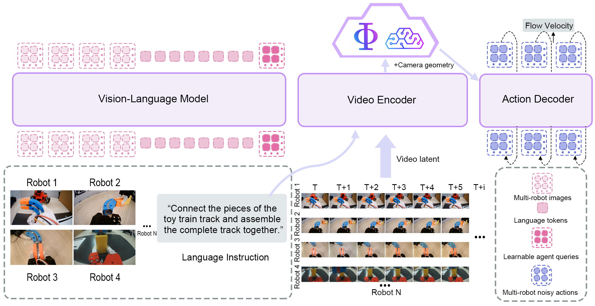
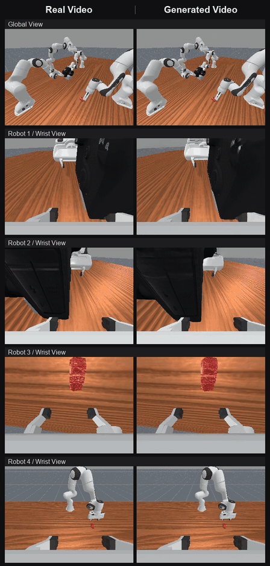
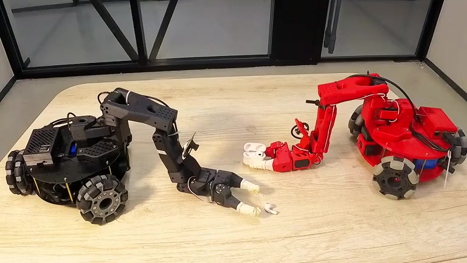
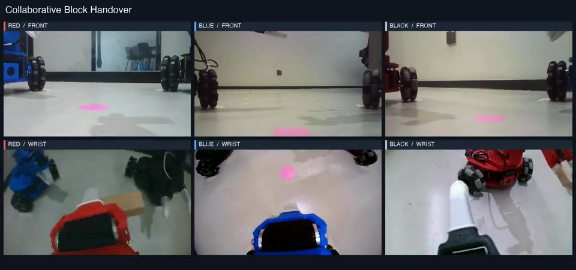

# worlddreamer-v5

[Project page](https://worldagents-c.github.io/worlddreamer-v5-project/)

## Model

worlddreamer-v5 is a unified world-action model for multi-robot collaborative control. It predicts coordinated actions from synchronized images, robot states and camera geometry. A vision-language backbone produces agent queries, a video expert encodes temporal observations and predicts future latents, and a three-plane spatial representation connects visual features to the action decoder.

The `lite` configuration contains 36 action layers and predicts 30 steps per robot, with a 20-dimensional state and an 18-dimensional action. The complete training model includes future-video and field-rendering objectives. This release supports **PlaceFood**, **CameraAlignment**, and **TakePhoto** in [RoboFactory](https://github.com/MARS-EAI/RoboFactory).



## Installation

Use Linux, NVIDIA CUDA, Python 3.10 and [uv](https://docs.astral.sh/uv/). Install the model and simulator in separate environments.

The distribution is named `worlddreamer-v5`; Python imports use `worlddreamer_v5`.

Training requires the CUDA 12.8 toolkit (`nvcc`) and a C++ compiler for the optimizer extension. Set `CUDA_HOME` to the toolkit directory if it is not installed at `/usr/local/cuda`.

```bash
uv venv --python 3.10 .venv
uv pip install --python .venv/bin/python -e '.[model,train]'
uv pip check --python .venv/bin/python
```

The model uses PyTorch 2.8.0, Transformers 4.57.1, Lightning 2.5.3 and DeepSpeed 0.18.9. Diffusers is pinned to source revision `fc77592427a3ad802ff4924ede31541d809097a2`; the installation command resolves it automatically.

For evaluation with the provided checkpoint, install FlashAttention 2 and Liger Kernel:

```bash
uv pip install --python .venv/bin/python --no-build-isolation \
  'flash-attn==2.8.3.post1' 'liger-kernel==0.6.5'
uv pip check --python .venv/bin/python
```

Install the simulator from [RoboFactory-new](https://github.com/worldAgents-c/robofactory-new), following [its installation instructions](https://github.com/worldAgents-c/robofactory-new#installation). Use commit [`f001478`](https://github.com/worldAgents-c/robofactory-new/tree/f001478f63e63ba04dc8a7654609c3d0212ca2f7) and its `robofactory/configs/worlddreamer/` configurations, which provide one global camera and one TCP-mounted wrist camera per robot. The simulator pins ManiSkill 3.0.0b12 and SAPIEN 3.0.0b1.

## Model weights

| Checkpoint | Variant | State dimensions | Action dimensions | Download |
| --- | --- | ---: | ---: | --- |
| Initialization | lite | 20 | 18 | [Hugging Face](https://huggingface.co/WorldAgents-c/worlddreamer-v5/tree/main/ckpt/world_dreamer_v5_init) |
| RoboFactory | lite | 20 | 18 | [Hugging Face](https://huggingface.co/WorldAgents-c/worlddreamer-v5/tree/main/ckpt/world_dreamer_v5_robofactory) |

Download both model packages:

```bash
uv tool run hf download WorldAgents-c/worlddreamer-v5 --include 'ckpt/*' --local-dir .
```

```text
ckpt/
  world_dreamer_v5_init/
  world_dreamer_v5_robofactory/
```

Each package contains `model.safetensors`, `model_config.json`, `checkpoint.json`, `normalize.json` and `assets/`.

## Data

The [RoboFactory dataset](https://huggingface.co/WorldAgents-c/worlddreamer-v5/tree/main/datasets/robofactory) contains 58 episodes: 19 PlaceFood, 20 CameraAlignment and 19 TakePhoto. Two versions are available:

- `raw/`: original simulator HDF5 trajectories, synchronized videos, camera configurations and physical-unit TCP annotations. The annotations include commanded targets computed from the recorded joint commands.
- `prepared/`: per-agent annotations, normalization statistics and precomputed video/text features, ready for the training and evaluation commands below.

Download the prepared version:

```bash
uv tool run hf download WorldAgents-c/worlddreamer-v5 \
  --include 'datasets/robofactory/prepared/*' --local-dir .
```

Its layout is:

```text
datasets/robofactory/prepared/
  manifest.json
  normalize.json
  calibration.json
  episodes/
  cache/
    manifest.json
    prompts.safetensors
    records/
```

Cache entries contain per-view video latents, camera geometry and depth. Paths are resolved relative to the dataset and cache manifests, so the directory can be relocated.

To build the same training layout from the raw release, download the raw data and the paired feature cache, then convert:

```bash
uv tool run hf download WorldAgents-c/worlddreamer-v5 \
  --include 'datasets/robofactory/raw/*' --include 'datasets/robofactory/prepared/cache/*' \
  --local-dir .
.venv/bin/python scripts/convert_raw_dataset.py \
  --raw datasets/robofactory/raw \
  --cache datasets/robofactory/prepared/cache \
  --output data/robofactory
```

For this converted version, replace `datasets/robofactory/prepared` with `data/robofactory` in the commands below.

## Training

```bash
export WORLDDREAMER_V5_MODEL_CHECKPOINT="$PWD/ckpt/world_dreamer_v5_init"
export WORLDDREAMER_V5_DATA="$PWD/datasets/robofactory/prepared"
export WORLDDREAMER_V5_VIDEO_CACHE="$WORLDDREAMER_V5_DATA/cache"
export WORLDDREAMER_V5_RUN="$PWD/outputs/train"
.venv/bin/python scripts/train.py --config configs/train.yaml
```

The recipe samples 4,200 scenes per task per epoch, uses one scene per GPU and accumulates four batches across four GPUs. Three epochs contain 2,364 optimizer updates, including the final partial accumulation group in each epoch. Change the scheduler and guard budgets together when changing the GPU count or sampling configuration.

Resume a training checkpoint with `--resume /path/to/checkpoint`. To export model weights without optimizer state, select the full Lightning checkpoint or the full DeepSpeed model-state file:

```bash
.venv/bin/python scripts/export_checkpoint.py \
  --checkpoint /path/to/model_states.pt \
  --template ckpt/world_dreamer_v5_init \
  --normalize "$WORLDDREAMER_V5_DATA/normalize.json" \
  --output ckpt/world_dreamer_v5_finetuned
```

## Evaluation

First check dataset decoding, tensor dimensions and model inputs:

```bash
.venv/bin/python scripts/validate.py \
  --checkpoint ckpt/world_dreamer_v5_robofactory \
  --attention-backend flash_attention_2 --kernel-backend liger \
  --data datasets/robofactory/prepared --data-only
```

Remove `--data-only` to run observed-only action prediction on recorded samples. Use `--samples-per-task 10` for more samples. This reports normalized action error, not environment success rate.

Start the model server:

```bash
.venv/bin/python scripts/serve.py \
  --checkpoint ckpt/world_dreamer_v5_robofactory \
  --cache datasets/robofactory/prepared/cache/manifest.json \
  --calibration datasets/robofactory/prepared/calibration.json \
  --attention-backend flash_attention_2 --kernel-backend liger \
  --device cuda:0
```

In another terminal, run the simulator with the RoboFactory environment's Python interpreter. Reserve a different GPU for rendering:

```bash
/path/to/robofactory/.venv/bin/python evaluation/evaluate.py \
  --task PlaceFood --env-seed 0 --policy-seed 0 \
  --calibration datasets/robofactory/prepared/calibration.json \
  --sim-cuda-device 1 --server-port 10100 --record-video
```

Repeat for `CameraAlignment` and `TakePhoto`. Episode results and optional videos are written under `outputs/evaluation/`. The simulator executes the active left-arm fields of each robot's 18-dimensional prediction; action masks retain the unused fields during training and inference.

## Results

### Future-view prediction

Predicted future observations from multiple robot viewpoints.

| Simulation | Real robots |
| :---: | :---: |
|  |  |

### Real-robot demonstrations

Click a preview to watch the complete video with synchronized camera views.

| Place Earbud in Case | Collaborative Block Handover |
| :---: | :---: |
| [](https://worldagents-c.github.io/worlddreamer-v5-project/assets/videos/real-world/full/place_earbud_in_case_success.mp4) | [](https://worldagents-c.github.io/worlddreamer-v5-project/assets/videos/real-world/full/collaborative_block_handover_success.mp4) |
| Two robots coordinate to place an earbud into its charging case. | Three robots pass a wooden block between them and place it at the target. |

More demonstrations are available on the [project page](https://worldagents-c.github.io/worlddreamer-v5-project/).

## Citation

The arXiv paper and BibTeX citation will be added to the [paper directory](https://huggingface.co/WorldAgents-c/worlddreamer-v5/tree/main/paper).
